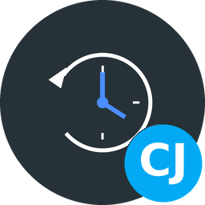

[![GitHub Release][releases-shield]][releases]
[![GitHub Activity][commits-shield]][commits]
[![License][license-shield]](LICENSE)
![Project Maintenance][maintenance-shield]

[](https://www.paypal.me/cyberjunkynl/)
[](https://github.com/sponsors/cyberjunky)

# Chronicle



A Home Assistant integration that keeps the history of your entities in [TimescaleDB](https://www.timescale.com/): every state change, compressed, for as long as you want. Home Assistant's own recorder keeps a few days for its screens; Chronicle keeps the years.

It is a new take on the idea of [LTSS](https://github.com/freol35241/ltss), which is no longer maintained, written from scratch for speed and reliability. Existing LTSS history can be imported.

## Features

- **Fast and light:** state changes are queued in memory and written in batches with PostgreSQL's `COPY` (tens of thousands of rows per second). Home Assistant itself never waits for the database.
- **Never loses data on a restart of the database:** while it can't be reached, states are kept in a queue and written once it is back; the connection is restored by itself.
- **Small:** history is compressed by TimescaleDB after a week, typically to a tenth of its size or less. Each entity is stored once and referred to by a number, and each distinct set of attributes is stored only once.
- **Averages that stay:** hourly and daily mean, minimum, maximum and last value of every numeric entity, kept up to date by TimescaleDB. You can remove the detailed history after a while and keep the averages for ever.
- **Set up in the UI:** connection, which entities, how long and how compact; no YAML.
- **Diagnostics:** sensors for the database size, the compression ratio, the queue, the rows written and the connection.
- **Actions:** write now, purge the history of entities, import LTSS history.
- **No compiling:** uses [asyncpg](https://github.com/MagicStack/asyncpg), which has ready-made packages for every Home Assistant platform, Raspberry Pi included.

## Requirements

A PostgreSQL server with the TimescaleDB extension (2.13 or newer), for example the [TimescaleDB app](https://github.com/cyberjunky/home-assistant-apps/tree/main/app-timescaledb). Its user must be allowed to create the extension and a schema in the database, which the `postgres` user is.

## Installation

### HACS

1. In HACS, open the menu (⋮) → **Custom repositories**, add `https://github.com/cyberjunky/home-assistant-chronicle` as an **Integration**.
2. Install **Chronicle** and restart Home Assistant.

### Manual

Copy `custom_components/chronicle` into your `config/custom_components` folder and restart Home Assistant.

## Setup

**Settings** → **Devices & services** → **Add integration** → **Chronicle**, then enter:

| Field | Example | |
|---|---|---|
| Host | `1b41fb55-timescaledb` | The TimescaleDB app's host name; or an IP address |
| Port | `5432` | |
| User name | `postgres` | |
| Password | | The TimescaleDB app's `postgres_password` |
| Database | `homeassistant` | Must exist; for the TimescaleDB app, list it under `databases` |

Chronicle creates its tables in a schema called `chronicle`, so it can share a database with other software, Home Assistant's recorder included.

## Options

**Settings** → **Devices & services** → **Chronicle** → **Configure**. Saving restarts Chronicle; nothing queued is lost.

**Which entities.** Without include rules every entity is recorded except the excluded ones. Domains, single entities and patterns (`sensor.*_power`) can be included and excluded: pick them from the list, or type a name and press Enter. Chronicle's own sensors are never recorded.

Worth excluding:

| | Why |
|---|---|
| Domains `automation` and `script` | Their state stays `on`; every run only changes `last_triggered`, which the logbook already keeps |
| Signal strength, uptime and "last seen" sensors | Change constantly and are rarely worth keeping |

To find the busiest entities, run in pgAdmin:

```sql
SELECT e.entity_id, count(*) FROM chronicle.states s JOIN chronicle.entities e ON e.id = s.entity
WHERE s.time > now() - interval '1 day' GROUP BY 1 ORDER BY 2 DESC LIMIT 20;
```

What was recorded before an exclusion stays; remove it with the action **Chronicle: Purge entities**.

**Storage.**

| Option | Default | |
|---|---|---|
| Record attributes | on | Each distinct set is stored once |
| Skip attribute-only changes | off | Only record a change when the state itself changes, not when only an attribute does |
| Hourly and daily averages | on | See [Averages](#averages) |
| Keep detailed history | 0 (for ever) | Days; at least 14 when set. The averages stay |
| Compress after | 7 days | |
| Chunk size | 7 days | Days of history per chunk, the unit that is compressed and removed |
| Write every | 5 s | Sooner when 2000 states are waiting |
| Queue while the database is away | 100000 | Beyond this the oldest states are dropped |

## What is stored

| Object | |
|---|---|
| `chronicle.states` | `time`, `entity` (id), `state`, `value`, `attributes` (id). A TimescaleDB hypertable |
| `chronicle.entities` | `id`, `entity_id`, `domain`, `name`, `unit`, `device_class`, `state_class`, `first_seen` |
| `chronicle.attributes` | `id`, `data` (jsonb): every distinct set of attributes once |
| `chronicle.history` | A view with everything joined: `time`, `entity_id`, `state`, `value`, `attributes` |
| `chronicle.states_hourly`, `chronicle.states_daily` | The averages |

A state that is a plain number (`21.5`, `-3`, `1e3`) is stored as a number in `value` and `state` is empty; the `history` view shows it as text again. `on` and `off` are stored as text with `value` 1 and 0, so the averages give the share of time something was on. Everything else (`unavailable`, `heat`, `nan`, `1_000`) is stored as text.

Examples:

```sql
-- The last day of one sensor
SELECT time, value FROM chronicle.history
WHERE entity_id = 'sensor.power' AND time > now() - interval '1 day' ORDER BY time;

-- Daily averages of last year
SELECT d.bucket, d.mean, d.min, d.max
FROM chronicle.states_daily d JOIN chronicle.entities e ON e.id = d.entity
WHERE e.entity_id = 'sensor.outdoor_temperature' AND d.bucket > now() - interval '1 year'
ORDER BY d.bucket;

-- Which entities write the most
SELECT e.entity_id, count(*) FROM chronicle.states s JOIN chronicle.entities e ON e.id = s.entity
WHERE s.time > now() - interval '1 day' GROUP BY 1 ORDER BY 2 DESC LIMIT 20;
```

## Averages

`states_hourly` and `states_daily` hold, per numeric entity, the mean, minimum, maximum, last value and the number of samples per hour and per local day (Home Assistant's time zone). TimescaleDB keeps them up to date in the background, and the newest hour comes from the detailed history on the fly. Removing detailed history (by **Keep detailed history** or a purge with **Keep days**) leaves the averages alone, so a year of daily averages takes almost no space.

## Actions

| Action | |
|---|---|
| `chronicle.flush` | Write the queue now |
| `chronicle.purge_entities` | Delete the history of entities. With `keep_days` only older history; without, the entities are removed completely, averages included. Returns the number of deleted rows |
| `chronicle.import_ltss` | Copy the history of the LTSS integration (table `public.ltss` in the same database) into Chronicle |

## Moving from LTSS

1. Install Chronicle with the database LTSS uses, and remove LTSS (or let them run side by side for a while).
2. Run the action **Chronicle: Import LTSS history**. It copies one day at a time in the background and shows a notification when it is done; if it is interrupted, running it again continues where it stopped. History that Chronicle recorded itself is not copied twice. The `ltss` table is not changed; drop it yourself once you are happy.

LTSS's `location` column is not copied: the coordinates are in the attributes as well.

## Diagnostics

The Chronicle device has these sensors: Connected (with the last error), Queue, Rows written, Dropped states, Last write, Database size, History size, Compression ratio, Rows, Entities and Oldest history. Write duration and Attribute sets are there too, but disabled by default.

### Debug logging

```yaml
logger:
  default: info
  logs:
    custom_components.chronicle: debug
```

## Development

```bash
docker run -d --name chronicle-test-db -p 55432:5432 -e POSTGRES_PASSWORD=test timescale/timescaledb:latest-pg18
python3 -m venv .venv && source .venv/bin/activate
pip install -r requirements_lint.txt asyncpg
pytest
./scripts/lint
```

The tests run against that database and are skipped when it isn't there.

## 💖 Support This Project

If you find this integration useful, please consider supporting its continued development:

[](https://www.paypal.me/cyberjunkynl/)
[](https://github.com/sponsors/cyberjunky)

## License

MIT, see [LICENSE](LICENSE). Thanks to [freol35241](https://github.com/freol35241) for LTSS, which showed how useful this is.

---

[releases-shield]: https://img.shields.io/github/release/cyberjunky/home-assistant-chronicle.svg?style=for-the-badge
[releases]: https://github.com/cyberjunky/home-assistant-chronicle/releases
[commits-shield]: https://img.shields.io/github/commit-activity/y/cyberjunky/home-assistant-chronicle.svg?style=for-the-badge
[commits]: https://github.com/cyberjunky/home-assistant-chronicle/commits/main
[license-shield]: https://img.shields.io/github/license/cyberjunky/home-assistant-chronicle.svg?style=for-the-badge
[maintenance-shield]: https://img.shields.io/badge/maintainer-cyberjunky-blue.svg?style=for-the-badge
